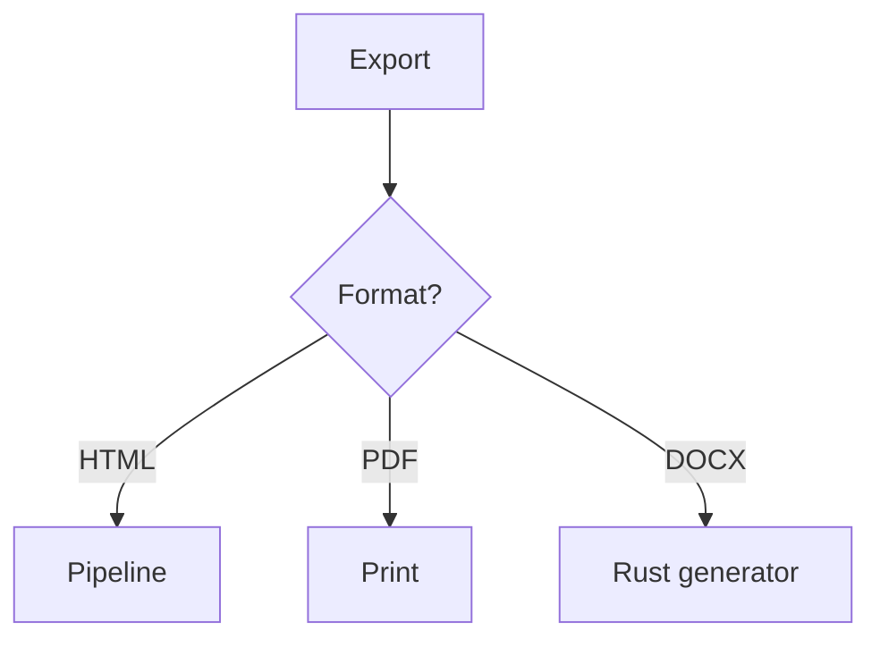

# Export Fidelity Fixture (AT-115)

Everything below must appear in HTML/PDF/DOCX output or carry a *documented,
visible* fallback — never a silent omission.

## Headings through every level

### Level three

#### Level four

##### Level five

###### Level six

## Links and images

[External link](https://example.com), [local sibling](./gfm-full.md) — wait, use a real path: [GFM](../markdown/gfm-full.md).


## Tables

| Name | Role | Notes |
|:-----|:----:|------:|
| Ada  |  CEO | left-center-right |
| Grace| Eng | second row |

## Code

```python
def answer() -> int:
    return 42
```

## Math

Inline $e^{i\pi} + 1 = 0$ and block:

$$
\oint_\gamma f(z)\,dz = 2\pi i \sum \text{Res}
$$

## Mermaid



## Lists and tasks

- one
- two
  - nested
- three
- [ ] unchecked task
- [x] checked task

## Blockquote

> A quoted paragraph with **bold** and `code`.

End of export fixture.
