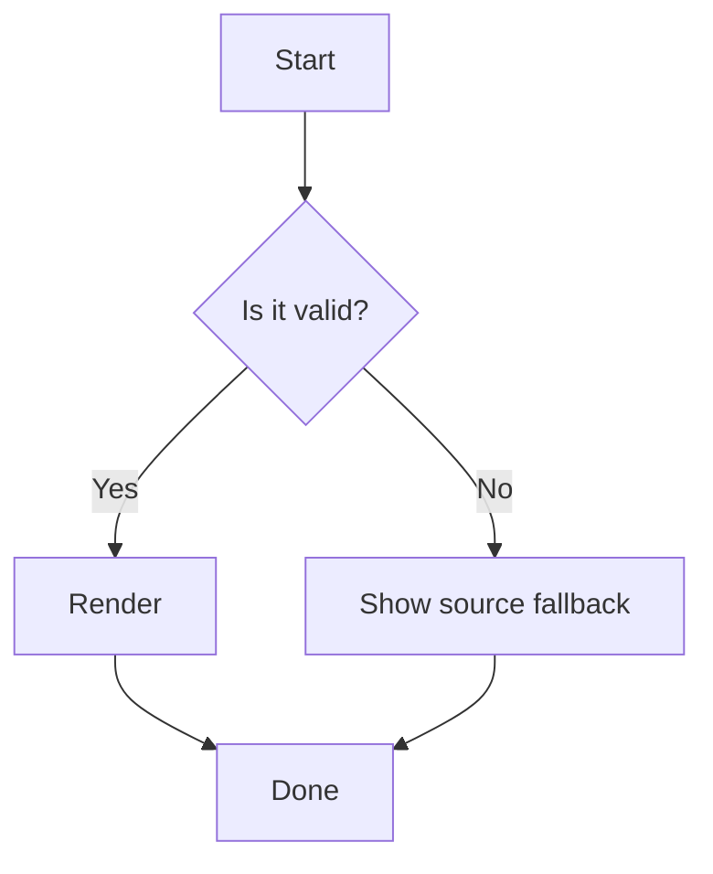
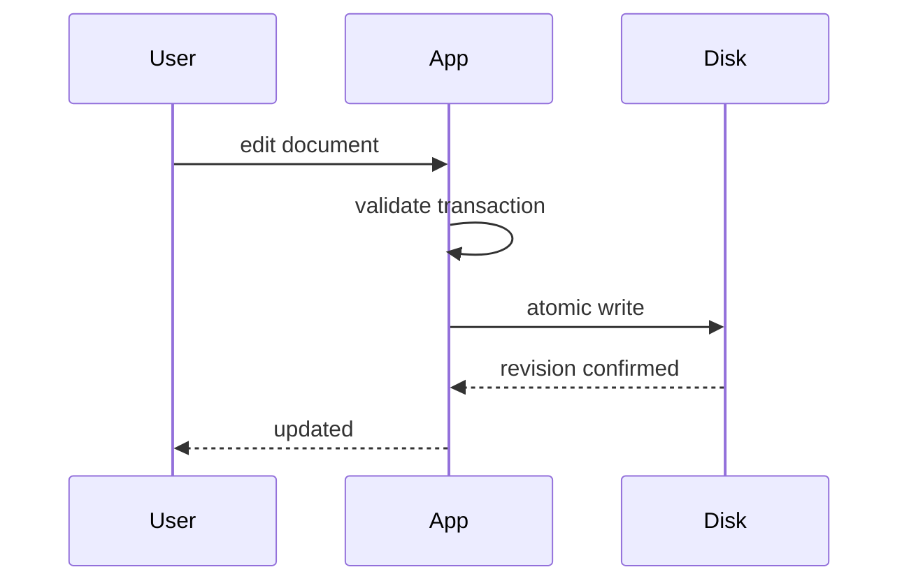
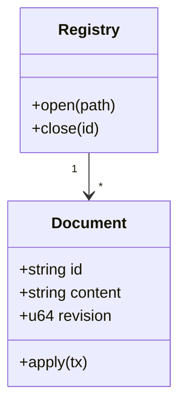

# Mermaid and Math Fixture

## Mermaid diagrams

### Flowchart



### Sequence diagram



### Class diagram



### Invalid diagram (must fall back to source + diagnostic, FR-024)

```mermaid
flowchart TD
    A[Start --> B
```

## Math

Inline math: the energy equation $E = mc^2$ and a fraction $\frac{a}{b}$ with
superscript $x^{2n}$ and subscript $H_2O$.

Block math:

$$
\int_{-\infty}^{\infty} e^{-x^2} \, dx = \sqrt{\pi}
$$

$$
\begin{aligned}
  L &= \frac{1}{2} m v^2 - V \\
  &= \int \left( \frac{\partial L}{\partial q} \dot{q} - \frac{\partial L}{\partial \dot{q}} \right) dt
\end{aligned}
$$

### Invalid math (must fall back, FR-025)

$$
\frac{unclosed {
$$

Mixed: a paragraph with $x_i$ inline and a following block:

$$
\sum_{i=1}^{n} x_i = n
$$

End of fixture.
